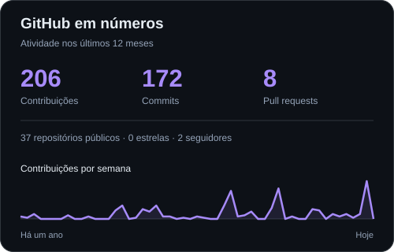
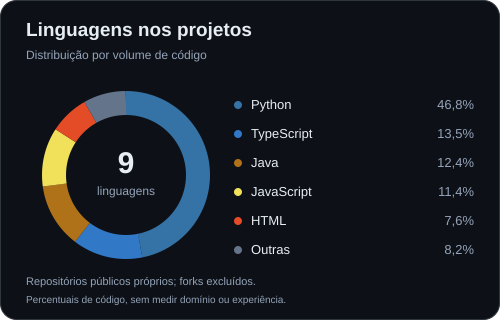
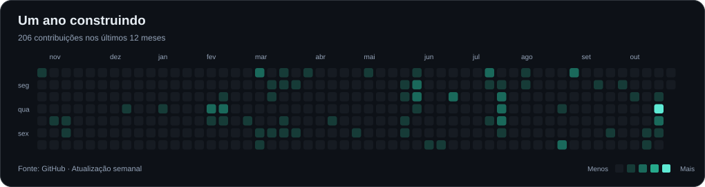

# Luiz Amaral

### Full Stack Developer · IA, aplicações e dados

Construindo aplicações que conectam interfaces, APIs e inteligência artificial.

**FluxoMind** · TypeScript / Node.js · Java / Spring Boot

---

## Sobre mim

Sou desenvolvedor Full Stack na **FluxoMind**, onde trabalho com aplicações e fluxos baseados em inteligência artificial. Conecto interfaces, APIs, bancos de dados e agentes para automatizar processos.

Meu foco está em **Full Stack com IA**: sistemas agênticos com **LangGraph**, pipelines de **RAG**, embeddings e recuperação semântica. Também desenvolvo com **Java, Spring Boot, TypeScript e Node.js**.

## Tecnologias

**Interfaces e aplicações**

**Dados e ferramentas**

**IA aplicada** · LangGraph · RAG · Embeddings · Busca semântica · pgvector · Gemini

## Minha atividade no GitHub

  
  

Dados do GitHub atualizados semanalmente. Linguagens por volume de código em repositórios públicos próprios, sem forks.

---

**Vamos conversar sobre aplicações, IA e novas ideias.**

[Mais projetos no GitHub](https://github.com/lzAmaral?tab=repositories) · [Meu portfólio](https://luizamaral.vercel.app/) · [Vamos conversar](https://www.linkedin.com/in/luiz-amarall/)
